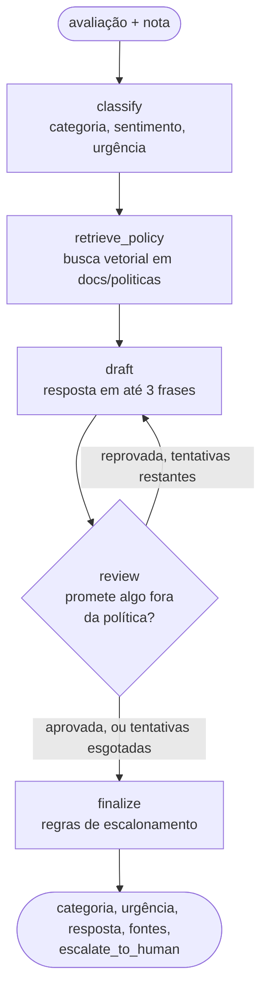

# reviews-triage-agent

Agente que lê avaliações de clientes de e-commerce em português, classifica o problema,
busca a política de atendimento certa e sugere uma resposta — com avaliação automática de
qualidade e custo.

> 🚧 Em construção. Este README é um esqueleto e será completado ao longo das fases.

## Problema de negócio

Plataformas de delivery e e-commerce recebem milhares de avaliações por dia. Triar à mão é
lento e inconsistente: a mesma reclamação recebe respostas diferentes dependendo de quem
atende, e casos urgentes se perdem no volume. O agente classifica, prioriza e rascunha a
resposta para um atendente revisar — o humano continua no controle da decisão final.

## Arquitetura

O agente é um grafo [LangGraph](https://langchain-ai.github.io/langgraph/) de quatro passos
mais um passo final sem LLM:



- **classify** devolve uma saída estruturada validada por Pydantic.
- **retrieve_policy** busca as 3 seções de política mais próximas (embeddings locais +
  Chroma).
- **draft** escreve a resposta usando só os trechos recuperados.
- **review** reprova respostas que prometem algo fora da política; o rascunho volta com o
  motivo uma vez; se reprovar de novo, o caso vai para um humano.
- **finalize** (código, sem LLM) marca `escalate_to_human` se a urgência for alta ou se a
  revisão não aprovou a resposta.

Os prompts ficam em [`prompts/`](prompts/), versionados no git; os relatórios registram o
hash de cada um.

### Política de atendimento (fictícia)

> ⚠️ **A política em [`docs/politicas/`](docs/politicas/) é fictícia.** Foi escrita para este
> projeto de portfólio e não representa a política de nenhuma empresa real. Cada arquivo traz
> esse aviso no topo.

O agente só pode prometer o que está nela: prazos de troca e devolução, reembolso em até
10 dias úteis no mesmo meio de pagamento, compensações por atraso (frete reembolsado a
partir de 3 dias úteis; acima de 7 dias úteis, o cliente escolhe entre cupom de 15% ou
cancelamento com reembolso total) e quem paga o frete de devolução.

## Dados

Usamos o [Brazilian E-Commerce Public Dataset by Olist](https://www.kaggle.com/datasets/olistbr/brazilian-ecommerce)
(Kaggle). Os dados brutos **não** são versionados.

1. Baixe o dataset no Kaggle (é preciso estar logado).
2. Copie `olist_order_reviews_dataset.csv` para `data/raw/`.
3. Rode `make data`. Isso gera em `data/processed/`:
   - `reviews_clean.csv`: só avaliações com comentário, texto normalizado (título + mensagem),
     uma linha por `review_id`;
   - `reviews_sample.csv`: amostra aleatória de 1.000 avaliações (seed 42) para desenvolvimento.

### Gold set (pré-rotulado por LLM, revisado por humano)

150 avaliações (30 por nota, sem textos repetidos) com categoria e urgência, usadas para medir o
baseline e o agente. Critérios em [`data/gold/LABELING_GUIDE.md`](data/gold/LABELING_GUIDE.md).

```bash
make gold            # sorteia as 150 avaliações (data/gold/to_label.csv)
make prelabel YES=1  # claude-fable-5-2 sugere categoria, urgência e justificativa (~US$ 4)
make gold-review     # revisão no terminal: Enter aceita, ou digite a correção
make gold-check      # valida data/gold/gold.csv
make gold-report     # % de sugestões corrigidas e concordância às cegas
```

30 das 150 (6 por nota) são revisadas **às cegas**: a pessoa rotula sem ver a sugestão, e ela
aparece depois. Isso mede a concordância real entre LLM e humano e quanto a sugestão ancora a
revisão.

O gold set contém trechos do dataset da Olist, distribuído sob licença
[CC BY-NC-SA 4.0](https://creativecommons.org/licenses/by-nc-sa/4.0/); o subconjunto rotulado
segue a mesma licença.

A exploração inicial (distribuição de notas, tamanho dos textos) está em
[`notebooks/01_exploration.ipynb`](notebooks/01_exploration.ipynb).

## Como rodar

Pré-requisitos: [uv](https://docs.astral.sh/uv/) e `make`.

```bash
cp .env.example .env   # preencha ANTHROPIC_API_KEY e ANTHROPIC_MODEL
make install
make check             # lint + testes (não usam chave de API: o LLM é simulado)
```

Para testar o agente em uma avaliação (usa a API e baixa o modelo de embeddings, ~470 MB, na
primeira vez):

```bash
make triage TEXT="Meu pedido chegou 10 dias atrasado e ninguém responde" SCORE=1
make policy-search Q="pedido atrasado"   # só a busca, sem LLM
```

`make help` lista todos os comandos.

## Avaliação

`make eval` roda o agente nas 150 avaliações do gold set e grava `reports/eval_<data>_<modelo>.md`:

- **Categoria:** F1 macro do agente contra o baseline, com intervalo de confiança de 95%
  (bootstrap pareado);
- **Urgência:** accuracy e recall dos casos de urgência alta;
- **Busca:** hit rate (o documento de política esperado está entre as fontes?), com uma
  comparação sem LLM entre consultas com e sem a dica de categoria;
- **LLM-as-judge:** nota de 1 a 5 para aderência à política, tom e utilidade, com rubrica
  explícita em [`prompts/judge.md`](prompts/judge.md);
- **Operação:** taxa de escalonamento, custo por 1.000 avaliações e latência p50/p95.

O juiz é o `claude-fable-5-2`, fixo em todas as rodadas e diferente de todos os modelos
comparados; a rubrica foi congelada (hash `c4a1e9c6`, versão 2) antes de qualquer rodada real. Cada
rodada salva os resultados brutos em `reports/runs/<rodada>/` (com commit, hashes dos prompts
e do gold set), e `make eval-compare` monta a tabela entre rodadas, avisando se alguma não for
comparável.

```bash
make eval-retrieval                                        # grátis: só a busca
make eval MODEL=claude-sonnet-5-5 JUDGE_SAMPLE=60          # mostra a estimativa e para
make eval MODEL=claude-sonnet-5-5 JUDGE_SAMPLE=60 YES=1    # rodada completa
make eval-compare
```

`JUDGE_SAMPLE=60` faz o juiz avaliar só 60 das 150 respostas: uma amostra estratificada por
categoria e **a mesma para todos os modelos**. F1, busca, custo e latência continuam medidos
nas 150.

### Piloto e validação humana do juiz

Antes das rodadas completas:

```bash
make pilot MODEL=claude-sonnet-5-5 YES=1   # 30 avaliações fora do gold set
make judge-agreement                        # depois de dar as suas notas
```

O piloto roda em avaliações **fora** do gold set, para não influenciar a rotulagem. Ele mede o
custo real e projeta o custo das rodadas completas. Também gera
`data/judge_validation/<rodada>/to_score.csv`, onde uma pessoa dá notas às mesmas respostas, às
cegas (sem ver as notas do juiz), com a mesma rubrica. O `make judge-agreement` mede a
concordância contra um critério de aprovação definido antes de existir qualquer nota.

## Resultados

### Rotulagem do gold set

<!-- auto:rotulagem -->
_Ainda não medido: `make gold-review` e depois `make gold-report`._
<!-- /auto:rotulagem -->

### Validação do juiz (LLM-as-judge × humano)

<!-- auto:validacao-juiz -->
_Ainda não medido: `make pilot` e depois `make judge-agreement`._
<!-- /auto:validacao-juiz -->

Os dois blocos acima são gerados a partir de `reports/` (`make readme`), sem cópia manual.

**Baseline clássico** (`make baseline`): TF-IDF + Regressão Logística, avaliado com validação
cruzada repetida no gold set. Relatório completo em [`reports/baseline.md`](reports/baseline.md).

_(Fase 5 — tabela baseline vs. agente, custo por 1.000 avaliações.)_

## Limitações e próximos passos

- **O gold set não tem a distribuição da produção.** Ele é estratificado por nota (30 de cada),
  enquanto na base real as notas altas são maioria. Isso dá exemplos suficientes de cada tipo
  de problema, mas as métricas medidas nele (sobretudo accuracy e o custo médio) não são
  exatamente as que se veria em produção. O F1 macro é menos afetado, porque pesa cada
  categoria igualmente.
- **Rótulos pré-gerados por LLM e revisados por humano.** As sugestões de categoria e urgência
  vieram do `claude-fable-5-2` (effort `medium`), com o prompt
  [`prompts/prelabel.md`](prompts/prelabel.md) mais os critérios do `LABELING_GUIDE.md`, versão
  `101fec44`. Uma pessoa revisou cada linha. Dois riscos: **ancoragem** (quem revisa aceita
  sugestões erradas com mais facilidade do que erraria rotulando do zero) e **circularidade**
  (o agente também é um Claude; erros que ele compartilha com o pré-rotulador, se não forem
  corrigidos, contam como acertos dele). Por isso 30 avaliações foram rotuladas às cegas, e o
  relatório de avaliação mostra com que frequência o agente repetiu os erros que o humano
  corrigiu. O baseline TF-IDF não tem esse viés, então a comparação agente × baseline pode
  favorecer o agente.
- **Um único anotador humano.** A única medida de concordância é entre a pessoa e o LLM, no
  subconjunto cego.

_(Demais itens na Fase 7.)_

## Decisões

As decisões de projeto (o quê, por quê e a alternativa descartada) estão em
[DECISIONS.md](DECISIONS.md).
